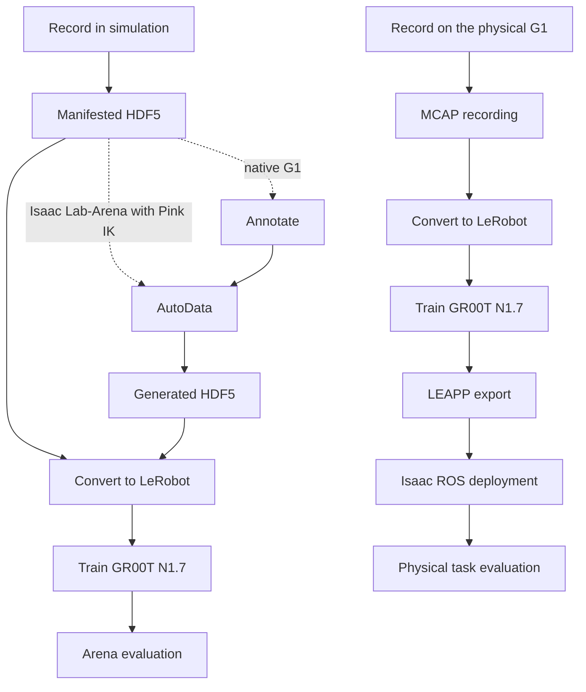
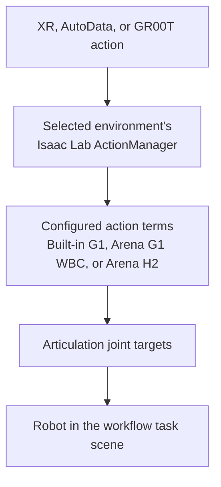

<!--
SPDX-FileCopyrightText: Copyright (c) 2026 NVIDIA CORPORATION & AFFILIATES. All rights reserved.
SPDX-License-Identifier: Apache-2.0

Licensed under the Apache License, Version 2.0 (the "License");
you may not use this file except in compliance with the License.
You may obtain a copy of the License at

    http://www.apache.org/licenses/LICENSE-2.0

Unless required by applicable law or agreed to in writing, software
distributed under the License is distributed on an "AS IS" BASIS,
WITHOUT WARRANTIES OR CONDITIONS OF ANY KIND, either express or implied.
See the License for the specific language governing permissions and
limitations under the License.
-->

# Architecture and Data Requirements

The repository is a reference implementation built on NVIDIA Isaac Lab for
composing a robot-learning workflow from thin stages. The current workflow paths use
Unitree G1 and Unitree H2 Plus robots to move an apple to a plate. They provide a
reproducible path from simulation and XR demonstration collection through
post-training and closed-loop simulator evaluation. Physical Unitree G1 deployment
guidance is also in scope for this documentation. The executable workflow
described here ends at simulator evaluation. Simulator validation does not
validate behavior on the physical robot.

See [Conceptual Overview](concepts-overview.md) for the role of each stage and the
distinction between the simulation and physical data paths.

## Pipeline

[Isaac AutoData](../how-to/generate-data-with-autodata.md) is the optional branch: it
amplifies a few recorded episodes into many. Demonstrations recorded with Unitree G1 in native Isaac Lab require an
annotation stage; AutoData-compatible Isaac Lab-Arena recordings made with Pink IK contain
`datagen_info`. Joint-control recordings are not AutoData inputs.

Conversion uses the robot-specific configuration and articulation targets rather
than treating raw inputs to the robot-control software as interchangeable. Unitree G1 conversion writes a
43-D joint state and target; Unitree H2 writes a 75-D joint state and target. Their GR00T
modalities expose 31-D state/35-D action for Unitree G1 and 75-D state/61-D action for
Unitree H2. Demonstrations recorded with G1 using Pink IK and AGILE in Isaac Lab-Arena, or
with AGILE in native Isaac Lab, including generated data, provide the
navigation and base-height fields required by the supplied G1
configuration. Demonstrations recorded with a fixed-base G1 omit them and need custom training
and inference integration. Demonstrations recorded with H2 in Isaac Lab-Arena provide navigation only, as
required by its separate modality. Policy post-training for Unitree H2 has been validated.
Learned-policy evaluation is implemented but not yet validated.

Both acquisition paths produce LeRobot datasets, but the resulting datasets and
checkpoints are not interchangeable by format alone. Each retains the camera,
robot-state and action formats, timing, robot configuration, and task settings
of its source.

## Robot-Control Software

Actions enter the selected environment's `ActionManager`, which dispatches its
configured action terms to run the robot-control software; that software does
not feed the manager. The three robot-control setups are mutually exclusive
environment configurations. In the
built-in Unitree G1 task, fixed mode
omits the lower-body action term and pins the base. Agile mode adds the AGILE
lower-body term alongside Pink and records its locomotion commands.

Isaac Lab-Arena Unitree G1 instead combines upper- and lower-body control inside one WBC action
term. It runs a separately pinned AGILE artifact and takes a different
locomotion command shape. `sim-agile-locomotion` and
`sim-arena-locomotion` therefore qualify both, against
[one shared set of behavior limits](../reference/development.md#validating-the-arena-locomotion-path).

Unitree H2 is Isaac Lab-Arena-only and uses separate upper-body and lower-body terms. Its recording
embodiment combines pelvis-relative Pink flange targets, 44 Sharpa joint targets,
and a three-value AGILE velocity command. Trigger or squeeze input from the
handheld XR controllers is converted into a binary open/close command with
hysteresis, which expands into those hand targets. The evaluation
embodiment replaces Pink with named upper-body joint targets while retaining the
same AGILE velocity tail.

The built-in Unitree G1 Pink-plus-AGILE runtime is active. The separately named
`g1_pink_ik_agile_stabilized` controller-profile metadata remains planned and
cannot be selected as a recording-ready profile.

## Where the Scene Comes From

Isaac Lab-Arena composes the scene, embodiment, and task for Arena-based Unitree G1
runs and all Unitree H2 simulation runs. The native Isaac Lab scripts
for recording demonstrations and driving Unitree G1 build the scene through `G1StaticAppleEnvCfg`. This
remains a supported path and manual behavior cross-check. The two Unitree G1
runtimes use the same task definition, which
`sim-common-environment` compares, but their robot-control software and raw action formats
are not interchangeable.
[Environment ownership](../reference/development.md#environment-ownership) describes
the supported paths and their validation boundaries.
